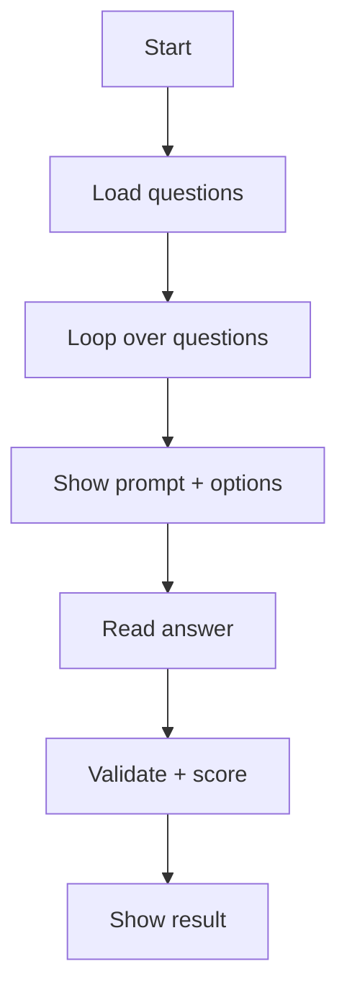

# Project 5 — Interactive Quiz Game

## 1. Introduction

Build a **console quiz game**: load questions, ask them one by one, score the answers, and show a result screen. Add variety with multiple choice, true/false, and a timer. It's a fun way to practice OOP, collections, and streams.

---

## 2. Why This Project Is Important

- Full **object-oriented design** in a compact app.
- Practises **collections, streams, and enums**.
- A great demo project for interviews — it shows clean design.

---

## 3. Real-World Analogy

Think of **trivia nights**: a host reads questions, players answer, and scores are tallied. Your app plays the role of both host and scorekeeper.

---

## 4. Theory — Design

### Features
| Feature | Behavior |
|---------|----------|
| Load quiz | Questions from a list or file |
| Ask | Show question + options |
| Answer | Validate and score |
| Timer (hard) | Limit time per question |
| Result | Show score and grade |

### Classes
| Class | Responsibility |
|-------|----------------|
| `Question` | Text, options, correct index |
| `QuestionType` (enum) | MULTIPLE_CHOICE, TRUE_FALSE |
| `Quiz` | Loads and holds questions |
| `QuizEngine` | Asks, scores, reports |
| `QuizApp` | Main loop + user input |

---

## 5. Syntax (Core Pattern)

```java
for (Question q : quiz.getQuestions()) {
    System.out.println(q.prompt());
    int answer = readAnswer();
    score += (q.isCorrect(answer)) ? 1 : 0;
}
```

---

## 6. Flow Explanation



---

## 7. Memory Representation

`Quiz` holds a `List<Question>`; each `Question` owns its options in a `List<String>` and the index of the right answer. No global state — the engine just iterates.

---

## 8. Simple Example — Question Model

```java
enum QuestionType { MULTIPLE_CHOICE, TRUE_FALSE }

class Question {
    private final QuestionType type;
    private final String text;
    private final List<String> options;
    private final int correctIndex;

    Question(QuestionType type, String text, List<String> options, int correctIndex) {
        this.type = type;
        this.text = text;
        this.options = options;
        this.correctIndex = correctIndex;
    }

    public String prompt() {
        StringBuilder sb = new StringBuilder(text).append('\n');
        for (int i = 0; i < options.size(); i++) {
            sb.append("  ").append(i + 1).append(". ").append(options.get(i)).append('\n');
        }
        return sb.toString();
    }

    public boolean isCorrect(int answer) { return answer == correctIndex; }
}
```

---

## 9. Intermediate Example — Quiz Engine

```java
class QuizEngine {
    private final Scanner in = new Scanner(System.in);

    public int run(Quiz quiz) {
        int score = 0;
        for (Question q : quiz.getQuestions()) {
            System.out.println(q.prompt());
            int answer = readInt();
            if (q.isCorrect(answer - 1)) {
                score++;
                System.out.println("Correct!");
            } else {
                System.out.println("Wrong!");
            }
        }
        return score;
    }

    private int readInt() {
        while (!in.hasNextInt()) in.next();
        return in.nextInt();
    }
}
```

---

## 10. Advanced Example — Timer + Result Screen

```java
class QuizEngine {
    // ...

    public int run(Quiz quiz) {
        int score = 0;
        for (Question q : quiz.getQuestions()) {
            System.out.println(q.prompt());
            int answer = timedRead(10);          // 10 seconds
            if (answer == -1) {
                System.out.println("Time's up!");
                continue;
            }
            if (q.isCorrect(answer - 1)) { score++; System.out.println("Correct!"); }
            else System.out.println("Wrong!");
        }
        return score;
    }

    private int timedRead(int seconds) {
        // Uses a separate thread + polling loop (see module 14)
        int[] answer = { -1 };
        Thread t = new Thread(() -> answer[0] = in.nextInt());
        t.start();
        long deadline = System.currentTimeMillis() + seconds * 1000L;
        while (t.isAlive() && System.currentTimeMillis() < deadline) { /* wait */ }
        t.interrupt();
        return answer[0];
    }
}
```

---

## 11. Output

```
What is the capital of France?
  1. Berlin
  2. Paris
  3. Madrid
> 2
Correct!
...
You scored 4 / 5
Grade: B
```

---

## 12. Common Mistakes

| Mistake | Correction |
|---------|------------|
| Off-by-one on option index | Convert user input to 0-based |
| Mutable question options | Unmodifiable lists |
| `in.nextInt()` left in buffer | Consume the newline |
| Blocking `nextInt()` in timer | Read on a separate thread |
| String parsing for true/false | Use enum or `Boolean.parseBoolean` |

---

## 13. Best Practices

- Model the domain with small classes (`Question`, `Quiz`).
- Keep the engine free of print formatting (or isolate it).
- Defensive copies for option lists.
- Clear, consistent prompt formatting.

---

## 14. Interview Questions

**Q1. Why an enum for question type?**
*Type-safe, no magic strings.*

**Q2. How would you load questions from a file?**
*CSV or JSON, one `Question` per line, parse into objects.*

**Q3. How does the timer approach work?**
*Reader on a separate thread; main loop polls the deadline.*

**Q4. How do you test the engine?**
*Inject a `Scanner` with canned input; assert the score.*

**Q5. Why unmodifiable lists?**
*Prevents accidental mutation after construction.*

---

## 15. Practice Exercises

1. Add a true/false question type.
2. Add a `skip` command.
3. Show per-question feedback text.
4. Add difficulty levels.

---

## 16. Coding Challenges

1. **Easy:** Load questions from a CSV file.
2. **Medium:** Add the 10-second timer.
3. **Hard:** Add a high-score leaderboard persisted to a file.

---

## 17. Summary

- Clean OOP design with enums and immutable models.
- Collections, streams, and optional concurrency (timer).
- Complete, demoable app for your portfolio.

➡️ Continue to: [Portfolio Guidance](Portfolio-Guidance.md)