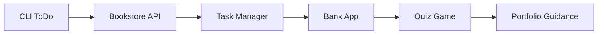

# 36 — Mini Projects

> **Experience level: 🔴 Expert (3 – 5 years)**

Apply everything so far by building **real mini projects**: a CLI app, a REST API, and a full-stack-style task manager. Each project has a complete step-by-step guide.

---

## 📂 Files in This Module

| File | What You'll Build |
|------|-------------------|
| [Project-1-CLI-ToDo.md](Project-1-CLI-ToDo.md) | Console task manager |
| [Project-2-REST-Bookstore.md](Project-2-REST-Bookstore.md) | Spring Boot + JPA API |
| [Project-3-Task-Manager.md](Project-3-Task-Manager.md) | Secure full-featured API |
| [Project-4-Bank-Console-App.md](Project-4-Bank-Console-App.md) | Banking with files/JDBC |
| [Project-5-Quiz-Game.md](Project-5-Quiz-Game.md) | Interactive quiz app |
| [Portfolio-Guidance.md](Portfolio-Guidance.md) | How to present projects |

---

## 🎯 Learning Objectives

By the end of this module, you will be able to:

1. ✅ Build a complete CLI application.
2. ✅ Build a Spring Boot REST API with persistence.
3. ✅ Add validation, security, and tests.
4. ✅ Combine everything into portfolio-ready projects.

---

## 🧭 Module Map



---

## 📌 Quick Preview

```java
@RestController
@RequestMapping("/api/books")
class BookController {
    @GetMapping
    public List<Book> all() { return repo.findAll(); }
}
```

---

## Next Module

➡️ [37 — Advanced Projects](../37-Advanced-Projects/README.md) — enterprise-grade builds.