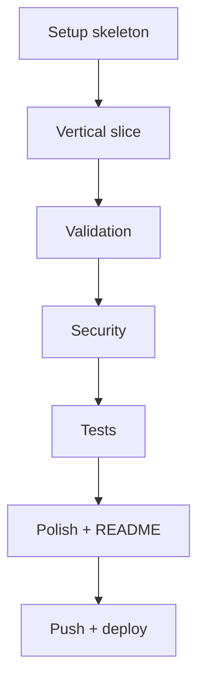

# 37 — Advanced Projects: Exercises

## 1. Introduction

Milestones and checklists for all five advanced projects. Plan **2–4 weeks per project**, commit after every milestone, and don't move on until each check is green.

---

## 2. Why These Matter

- Advanced projects fail from scope creep, not hard code.
- Milestones keep each build shippable and reviewable.
- Checklists are what interviewers actually probe.

---

## 3. Real-World Analogy

Like a **building's inspection checklist**: each floor must pass inspection before the next is built. Green milestones = a portfolio you can defend.

---

## 4. Theory — The Milestone Rule

1. **Vertical slice first:** one tiny end-to-end flow working (e.g., list products → order → event), then broaden.
2. Commit after each milestone with a clear message.
3. Write the test alongside the feature, not after.

---

## 5. Syntax — Milestone Checklist Format

```text
[ ] M1  Project boots with default config
[ ] M2  Core happy path works end to end
[ ] M3  Validation + error handling
[ ] M4  Security (auth/roles)
[ ] M5  Tests green
[ ] M6  Docker + README
```

---

## 6. Flow — Typical Project Sprint



---

## 7. Memory Representation

Each milestone is a **commit** in git history — your Git log becomes the story of the project. Interviewers check it.

---

## 8. Project 1 — E-Commerce Backend Checklist

```text
[ ] M1  Spring Boot app + H2/MySQL + entities (Product, Order)
[ ] M2  Catalog CRUD + GET products with pagination
[ ] M3  Cart add/remove + total
[ ] M4  Place order: transaction, stock decrement
[ ] M5  JWT auth: customer can only see own orders
[ ] M6  Caching on GET products (Caffeine)
[ ] M7  Tests: cart, order, insufficient stock
[ ] M8  Docker Compose (app + MySQL), README
```

---

## 9. Project 2 — Real-Time Chat Checklist

```text
[ ] M1  WebSocket + STOMP config, echo endpoint
[ ] M2  Send/receive messages on a topic
[ ] M3  Rooms via topic per room id
[ ] M4  JWT in the handshake
[ ] M5  Redis: history + presence
[ ] M6  Typing indicator
[ ] M7  Tests: STOMP session sends/receives
[ ] M8  Live demo instructions + README
```

---

## 10. Project 3 — Microservices System Checklist

```text
[ ] M1  Eureka server up, services register
[ ] M2  Gateway routes /api/** to services by name
[ ] M3  user-service: register + login + JWT
[ ] M4  catalog-service: products CRUD
[ ] M5  order-service: WebClient → catalog
[ ] M6  Circuit breaker + fallback on catalog call
[ ] M7  Distributed tracing (Micrometer + Zipkin)
[ ] M8  Docker Compose for all services
```

---

## 11. Project 4 — Banking Platform Checklist

```text
[ ] M1  Account entity + deposit/withdraw endpoints
[ ] M2  Transfer: transaction, fixed lock order
[ ] M3  BigDecimal everywhere, insufficient-funds error
[ ] M4  Transactions + audit log tables
[ ] M5  Roles: customer vs admin, ownership checks
[ ] M6  Statement + pagination
[ ] M7  Concurrency stress test (no lost updates)
[ ] M8  README + run instructions
```

---

## 12. Project 5 — Event-Driven Orders Checklist

```text
[ ] M1  Kafka up (Docker), order.placed published
[ ] M2  Inventory consumer reserves stock
[ ] M3  order.reserved published + consumed
[ ] M4  Idempotency: duplicate events safe (dedupe store)
[ ] M5  Keyed producer per order id (ordering)
[ ] M6  Manual offsets + dead-letter topic
[ ] M7  Replay test: reset offset, state rebuilt
[ ] M8  README + diagram of topics
```

---

## 13. Common Mistakes

| Mistake | Fix |
|---------|-----|
| One giant commit at the end | Milestone commits |
| No tests until "done" | Test each feature as built |
| Scope creep (10 features) | Vertical slice, then broaden |
| Skipping the README | Write it while building |
| Not verifying locally | Docker + scripts to run |

---

## 14. Best Practices

- Keep every milestone runnable: `mvn spring-boot:run` works after each.
- CI (GitHub Actions) runs tests on every push.
- Use a `docs/` folder for diagrams and API notes.
- Deploy at least one project to show it live.

---

## 15. Practice Exercises

1. Write a 1-paragraph summary per project for LinkedIn.
2. Add a CI pipeline for one project.
3. Create a diagram (mermaid) of each architecture.
4. Add a `docker-compose.yml` for each project.

---

## 16. Coding Challenges

1. **Easy:** Timebox M1 of Project 1 to one evening.
2. **Medium:** Combine Projects 1 + 5 (e-commerce → event-driven).
3. **Hard:** Deploy the microservices system with Docker Compose and live URLs.

---

## 17. Summary

- Milestones make advanced projects achievable.
- Commit, test, and document as you build.
- Finish at least 2 of the 5 projects to complete the roadmap.

➡️ Continue to: [38 — Interview Preparation](../38-Interview-Preparation/README.md)