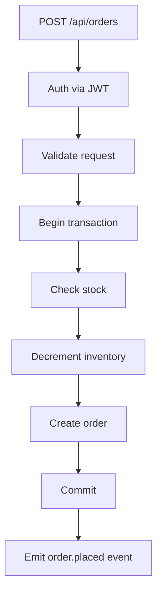

# Project 1 — E-Commerce Backend

## 1. Introduction

Build a **production-grade e-commerce backend**: product catalog, shopping cart, orders, payments (mock), and inventory. It combines Spring Boot, JPA, validation, security, caching, and Docker.

---

## 2. Why This Project Is Important

- The classic "full backend" interview project.
- Touches almost every enterprise module: 25–31, 34, 35.
- Shows you can design real domain models (orders, inventory).

---

## 3. Real-World Analogy

This is the server behind **Amazon's product page**: browse products, add to cart, place an order, and watch inventory drop. Your API is that server.

---

## 4. Theory — Design

### Domain Model
| Entity | Key Fields |
|--------|-----------|
| `Product` | id, name, price, stock |
| `CartItem` | product, quantity |
| `Order` | id, user, items, total, status |
| `OrderItem` | product, price, quantity |

### Status Flow
`PLACED → PAID → SHIPPED → DELIVERED` (and `CANCELLED`).

### Key Decisions
- `BigDecimal` for money.
- Inventory decremented in the **same transaction** as order creation.
- Caching on hot reads (product list) via Spring Cache + Caffeine.

---

## 5. Syntax (Core Pattern)

```java
@Transactional
public Order place(OrderRequest req, Long userId) {
    Order order = buildOrder(req, userId);
    order.getItems().forEach(i -> inventory.decrement(i.getProductId(), i.getQty()));
    return orders.save(order);
}
```

---

## 6. Flow Explanation



---

## 7. Memory Representation

`Order` (one) holds a `List<OrderItem>` (many). JPA maps this as an `@OneToMany` with a foreign key on the `order_item` table — object graph ↔ relational model.

---

## 8. Simple Example — Entities

```java
@Entity
public class Order {
    @Id @GeneratedValue
    private Long id;
    private Long userId;
    private BigDecimal total;
    @Enumerated(EnumType.STRING)
    private OrderStatus status = OrderStatus.PLACED;

    @OneToMany(cascade = CascadeType.ALL, fetch = FetchType.LAZY)
    @JoinColumn(name = "order_id")
    private List<OrderItem> items = new ArrayList<>();
}
```

---

## 9. Intermediate Example — Cart & Product Service

```java
@Service
public class CartService {
    private final CartRepository carts;
    private final ProductRepository products;

    public Cart addItem(Long userId, Long productId, int qty) {
        Product product = products.findById(productId).orElseThrow(ProductNotFound::new);
        Cart cart = carts.findByUserId(userId).orElseGet(() -> newCart(userId));
        cart.addItem(product, qty);
        return carts.save(cart);
    }
}
```

---

## 10. Advanced Example — Transactional Order + Caching

```java
@Service
public class OrderService {
    private final OrderRepository orders;
    private final InventoryService inventory;
    private final OrderEventPublisher events;

    @Transactional
    public Order place(OrderRequest req, Long userId) {
        Order order = new Order(userId);
        for (OrderLine line : req.lines()) {
            inventory.decrement(line.productId(), line.qty());   // throws if short
            order.addItem(products.get(line.productId()), line.qty());
        }
        Order saved = orders.save(order);
        events.orderPlaced(saved);                                // async publish
        return saved;
    }
}

@Service
public class InventoryService {
    @Cacheable("product")
    public Product get(Long id) { return products.findById(id).orElseThrow(); }

    @Transactional
    public void decrement(Long productId, int qty) {
        // SELECT ... FOR UPDATE then UPDATE stock = stock - ?
        if (stock < qty) throw new InsufficientStockException(productId);
    }
}
```

---

## 11. Output

```
POST /api/cart {"productId":1,"qty":2}        → 200 {cartId:7, total:79.98}
POST /api/orders                              → 201 {id:101, status:"PLACED", total:79.98}
GET  /api/products                            → 200 (served from cache on repeat)
GET  /api/orders/101                          → 200 {status:"PLACED", items:[...]}
```

---

## 12. Common Mistakes

| Mistake | Correction |
|---------|------------|
| Double precision for money | `BigDecimal` |
| Inventory checked and decremented separately | Same transaction |
| Lazy `OrderItem` accessed outside tx | Fetch join or DTO projection |
| Caching stale product prices | Invalidate on update (`@CacheEvict`) |
| No idempotency on order placement | Client order-id or dedupe key |

---

## 13. Best Practices

- `@Transactional` around multi-step writes.
- DTOs for requests/responses; never expose entities.
- Cache reads, evict on writes.
- Idempotent order placement (retry-safe).
- Integration tests over the whole flow.

---

## 14. Interview Questions

**Q1. How do you prevent overselling?**
*Decrement inventory in the same transaction with row locking.*

**Q2. How does caching affect consistency?**
*Trade-off; use TTL + eviction on writes.*

**Q3. Why `BigDecimal`?**
*Exact decimal representation for money.*

**Q4. How do you make placement idempotent?**
*Store a client-supplied idempotency key and return the original result.*

**Q5. N+1 query problem here?**
*Items are fetched lazily; use `join fetch` or a DTO projection.*

---

## 15. Practice Exercises

1. Add a product search with pagination.
2. Add discount codes on the order.
3. Add a `PAID` step with a mock payment provider.
4. Add stock count endpoint (cached).

---

## 16. Coding Challenges

1. **Easy:** Add product categories.
2. **Medium:** Add a Redis-cached bestseller list.
3. **Hard:** Reconcile payment success against orders asynchronously (events).

---

## 17. Summary

- Full e-commerce domain: catalog, cart, orders, inventory.
- Transactions, caching, validation, and DTOs.
- The foundation for the event-driven project (Project 5).

➡️ Continue to: [Project 2 — Real-Time Chat](Project-2-Real-Time-Chat.md)