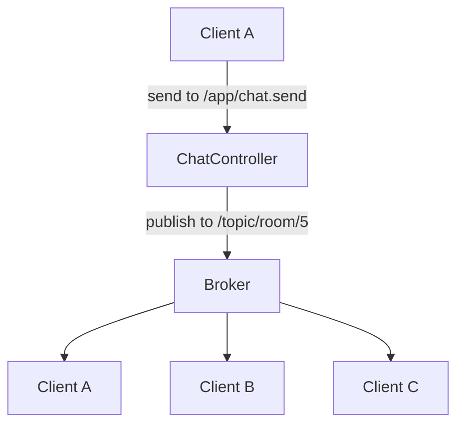

# Project 2 — Real-Time Chat

## 1. Introduction

Build a **real-time chat application**: users authenticate, join rooms, and exchange messages instantly via **WebSockets** with Spring (STOMP), a small frontend, and Redis for presence/state. This is your first push-based, not pull-based, app.

---

## 2. Why This Project Is Important

- Introduces **WebSockets** — the foundation of live features (notifications, dashboards, gaming).
- Combines auth (29), Spring (25–26), Redis (31), and a frontend.
- Visually impressive and easy to demo.

---

## 3. Real-World Analogy

**Slack or Discord**: you type a message and it appears on everyone's screen instantly — no refresh. The server *pushes* to connected clients instead of waiting for them to ask.

---

## 4. Theory — Design

### How WebSockets Work
- HTTP handshake upgrades to a persistent **full-duplex** connection.
- **STOMP** is a simple message protocol over WebSockets (topics like chat channels).
- Spring: `@MessageMapping` (client → server) and `@SendTo` / `SimpMessagingTemplate` (server → client).

### Components
| Component | Responsibility |
|-----------|----------------|
| `WebSocketConfig` | Enable + register STOMP endpoints |
| `ChatController` | `@MessageMapping("/chat.send")` |
| `ChatMessage` | sender, content, roomId, timestamp |
| `Redis` | Presence + room state (optional) |
| Frontend | STOMP JS client (sockjs + stomp.js) |

---

## 5. Syntax (Core Pattern)

```java
@MessageMapping("/chat.send")
@SendTo("/topic/room/{roomId}")
public ChatMessage send(ChatMessage message) {
    return message.withTimestamp(Instant.now());
}
```

---

## 6. Flow Explanation



---

## 7. Memory Representation

The connection is **not HTTP request-response**; a WebSocket holds an open socket per client, and the broker fans messages out to subscribers of a topic. In-memory broker (simple) or Redis for scaling across nodes.

---

## 8. Simple Example — Config

```java
@Configuration
@EnableWebSocketMessageBroker
public class WebSocketConfig implements WebSocketMessageBrokerConfigurer {

    @Override
    public void configureMessageBroker(MessageBrokerRegistry config) {
        config.enableSimpleBroker("/topic");        // server → client
        config.setApplicationDestinationPrefixes("/app"); // client → server
    }

    @Override
    public void registerStompEndpoints(StompEndpointRegistry registry) {
        registry.addEndpoint("/ws").setAllowedOriginPatterns("*").withSockJS();
    }
}
```

---

## 9. Intermediate Example — Message Controller

```java
@Controller
public class ChatController {

    @MessageMapping("/chat.send")
    @SendTo("/topic/room")
    public ChatMessage send(ChatMessage message) {
        return new ChatMessage(message.sender(), message.content(), Instant.now());
    }
}
```

```java
public record ChatMessage(String sender, String content, Instant timestamp) {}
```

---

## 10. Advanced Example — Room + Presence with Redis

```java
@Service
public class ChatService {
    private final SimpMessagingTemplate template;
    private final RedisTemplate<String, String> redis;

    @MessageMapping("/chat.send")
    public void send(ChatMessage message) {
        ChatMessage stamped = message.withTimestamp(Instant.now());
        template.convertAndSend("/topic/room." + message.roomId(), stamped); // to room
        redis.opsForList().rightPush("chat:" + message.roomId(), json(stamped)); // history
    }

    @MessageMapping("/chat.typing")
    public void typing(TypingEvent e) {
        template.convertAndSend("/topic/room." + e.roomId() + ".typing", e);
    }
}
```

---

## 11. Output

```
Client A (alice):  Hello everyone!
Client B (bob):    Hey alice!           (appears instantly, no refresh)
Client C (carol):  +1
History (reload):  [alice, bob, carol messages replayed from Redis]
```

---

## 12. Common Mistakes

| Mistake | Correction |
|---------|------------|
| Sending to a single user instead of topic | Use `/topic/room.id` |
| No CORS config | `setAllowedOriginPatterns` |
| Broker not enabled | `@EnableWebSocketMessageBroker` |
| Missing SockJS fallback | `withSockJS()` for compatibility |
| No auth on socket | Validate JWT in handshake |

---

## 13. Best Practices

- Authenticate during the handshake, not per message.
- Send only DTOs over the wire.
- Cap message size and rate-limit.
- Persist history (Redis/DB) so reloads aren't empty.
- Use topics per room — never a global topic for many rooms.

---

## 14. Interview Questions

**Q1. WebSocket vs HTTP polling?**
*WebSocket is a persistent full-duplex connection; polling repeats HTTP requests.*

**Q2. What is STOMP?**
*A lightweight messaging protocol on top of WebSockets with topics and frames.*

**Q3. How do you scale chat across multiple server nodes?**
*Shared broker (RabbitMQ/Redis) so all nodes see all messages.*

**Q4. How do you authenticate a WebSocket?**
*Validate the JWT in the handshake before upgrading.*

**Q5. How do you replay history?**
*Store messages in Redis/DB and load on join.*

---

## 15. Practice Exercises

1. Add a "typing..." indicator.
2. Add per-room message history endpoint.
3. Add read receipts.
4. Add a "connected users" list per room.

---

## 16. Coding Challenges

1. **Easy:** Broadcast join/leave notifications.
2. **Medium:** Rate-limit messages per user.
3. **Hard:** Replace the in-memory broker with RabbitMQ for horizontal scaling.

---

## 17. Summary

- WebSockets + STOMP for instant, pushed messaging.
- Auth in the handshake, DTOs on the wire, Redis for presence/history.
- A live, demoable app — great conversation starter in interviews.

➡️ Continue to: [Project 3 — Microservices System](Project-3-Microservices-System.md)