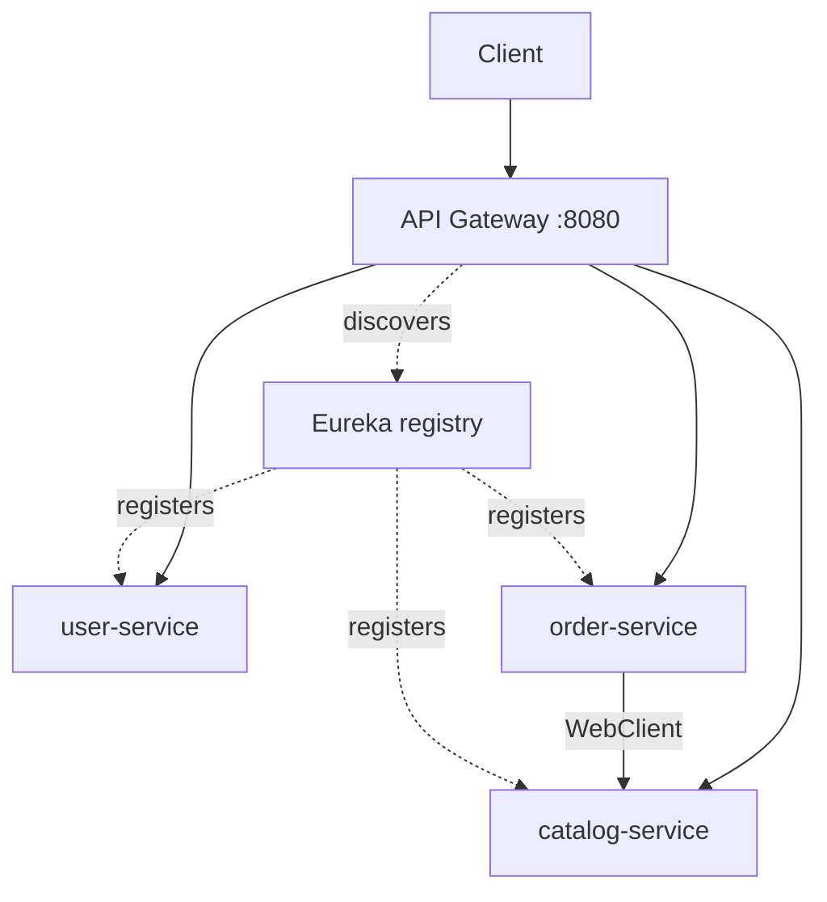

# Project 3 — Microservices System

## 1. Introduction

Take the e-commerce domain and **split it into microservices**: a catalog service, an order service, and a user/auth service — wired together with **service discovery, an API gateway, and inter-service communication**. This is the architecture behind large enterprise backends.

---

## 2. Why This Project Is Important

- Directly exercises module 32 (Microservices).
- Teaches service discovery, gateways, and resilience.
- Shows senior-level architectural thinking.

---

## 3. Real-World Analogy

Instead of one giant store, think of **separate departments that call each other over an internal phone network**: Catalog (products), Orders (sales desk), Users (front desk). A gateway is the single public entrance; discovery is the phone book.

---

## 4. Theory — Design

### Services
| Service | Responsibility | Port |
|---------|----------------|------|
| `eureka-server` | Service registry (Eureka) | 8761 |
| `gateway` | Public entry, routing, auth | 8080 |
| `user-service` | Auth, JWT, users | 8081 |
| `catalog-service` | Products | 8082 |
| `order-service` | Orders + inventory | 8083 |

### Communication
- **Sync:** REST via gateway / `WebClient` between services.
- **Async (optional):** events via Kafka for order → inventory.
- **Resilience:** Resilience4j circuit breaker on inter-service calls.

---

## 5. Syntax (Core Pattern)

```yaml
# application.yml (order-service)
spring:
  application:
    name: order-service
eureka:
  client:
    service-url:
      defaultZone: http://localhost:8761/eureka/
```

```java
// Gateway route
@Bean
RouteLocator routes(RouteLocatorBuilder b) {
    return b.routes()
        .route("orders", r -> r.path("/api/orders/**")
            .uri("lb://order-service"))
        .route("catalog", r -> r.path("/api/products/**")
            .uri("lb://catalog-service"))
        .build();
}
```

---

## 6. Flow Explanation



---

## 7. Memory Representation

Each service is its **own JVM process** and its **own database** (database-per-service). They only share the registry (Eureka) and messages (optional Kafka). No shared in-memory state — this is what makes them independently deployable.

---

## 8. Simple Example — Eureka Server

```java
@SpringBootApplication
@EnableEurekaServer
public class EurekaServerApplication {
    public static void main(String[] args) {
        SpringApplication.run(EurekaServerApplication.class, args);
    }
}
```

```yaml
# eureka-server application.yml
server.port: 8761
eureka.client.register-with-eureka: false
eureka.client.fetch-registry: false
```

---

## 9. Intermediate Example — Service Discovery Client

```java
@SpringBootApplication
@EnableDiscoveryClient
public class OrderServiceApplication {
    public static void main(String[] args) {
        SpringApplication.run(OrderServiceApplication.class, args);
    }
}
```

```java
// Look up a peer by its service name — Eureka resolves it
@Autowired
private DiscoveryClient discoveryClient;

public List<String> productServiceUrls() {
    return discoveryClient.getInstances("catalog-service")
        .stream().map(i -> i.getUri().toString()).toList();
}
```

---

## 10. Advanced Example — Resilient Inter-Service Call

```java
@Service
public class ProductClient {
    private final WebClient webClient;

    public ProductClient(WebClient.Builder builder) {
        this.webClient = builder.baseUrl("lb://catalog-service").build();
    }

    @CircuitBreaker(name = "catalog", fallbackMethod = "cachedProduct")
    public Mono<Product> getProduct(Long id) {
        return webClient.get().uri("/api/products/{id}", id).retrieve()
            .bodyToMono(Product.class);
    }

    public Mono<Product> cachedProduct(Long id, Throwable t) {
        return Mono.just(cache.get(id));   // stale read if catalog is down
    }
}
```

---

## 11. Output

```
GET http://localhost:8080/api/products/1
  → gateway → catalog-service
  → 200 {"id":1,"name":"Keyboard","price":49.99}

POST http://localhost:8080/api/orders   (JWT via gateway)
  → order-service → catalog-service (validate) → create order
  → 201 {"id":101,"total":49.99}
```

---

## 12. Common Mistakes

| Mistake | Correction |
|---------|------------|
| Calling `localhost:8082` directly | Always `lb://service-name` |
| One shared database | Database per service |
| No fallback | Circuit breaker + fallback method |
| Blocking calls between services | Reactive `WebClient` |
| Skipping the gateway | Centralize auth/routing there |

---

## 13. Best Practices

- Every request enters through the gateway.
- Services communicate by name, never by address.
- Circuit breakers + timeouts on inter-service calls.
- Distributed tracing (Micrometer + Zipkin) from day one.
- Contract testing between services.

---

## 14. Interview Questions

**Q1. Why microservices over a monolith?**
*Independent scaling, deployment, and team ownership — at the cost of complexity.*

**Q2. What is service discovery?**
*Services register and look each other up by name; Eureka/Consul.*

**Q3. What does the gateway do?**
*Single entry: routing, auth, rate limiting, aggregation.*

**Q4. How do you handle a downstream failure?**
*Circuit breaker, fallback, retries with backoff.*

**Q5. How do you trace a request across services?**
*Correlation id / distributed tracing (Micrometer Tracing).*

---

## 15. Practice Exercises

1. Add config server (Centralized-Configuration).
2. Add a `/actuator/health` endpoint to each service.
3. Add a correlation id header at the gateway.
4. Add rate limiting on the gateway.

---

## 16. Coding Challenges

1. **Easy:** Register all three services with Eureka.
2. **Medium:** Add a circuit breaker with fallback.
3. **Hard:** Replace order→catalog sync call with a Kafka event.

---

## 17. Summary

- Eureka discovery, gateway routing, per-service databases.
- Resilient inter-service calls with `WebClient` + circuit breakers.
- The architecture behind real enterprise backends.

➡️ Continue to: [Project 4 — Banking Platform](Project-4-Banking-Platform.md)