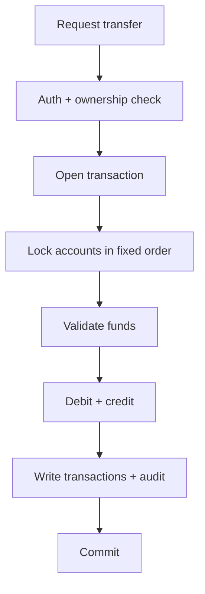

# Project 4 — Banking Platform

## 1. Introduction

Build a **secure banking platform**: accounts, deposits/withdrawals, transfers, an immutable audit log, and role-based access for customers and admins. This is the highest-stakes domain in backend engineering — correctness and security come first.

---

## 2. Why This Project Is Important

- Exercises **transactions, concurrency, and auditability** at scale.
- Shows you understand real constraints: money must never be lost or double-spent.
- Differentiates you from candidates who only build CRUD APIs.

---

## 3. Real-World Analogy

A bank's core system is a **double-entry ledger**: every movement has a debit and a credit, nothing is ever silently deleted, and a full history is kept forever. Your platform is a simplified version of that.

---

## 4. Theory — Design

### Rules
| Rule | Enforcement |
|------|-------------|
| No negative balance | Check + atomic update |
| Transfers are atomic | Single transaction, row locks |
| Every change is audited | Append-only `audit_log` |
| Only owner/admins act on an account | Role + ownership checks |
| Money is exact | `BigDecimal` everywhere |

### Tables
| Table | Notes |
|-------|-------|
| `accounts` | id, owner_id, balance (BigDecimal), locked |
| `transactions` | id, account_id, type, amount, ref, created_at |
| `audit_log` | who, what, when, immutable |

---

## 5. Syntax (Core Pattern)

```java
@Transactional
public void transfer(Long from, Long to, BigDecimal amount) {
    Account a = lock(from);                 // SELECT ... FOR UPDATE
    Account b = lock(to);                   // fixed lock order
    a.debit(amount); b.credit(amount);      // BigDecimal arithmetic
    audit("TRANSFER", from, amount);
}
```

---

## 6. Flow Explanation



---

## 7. Memory Representation

Concurrency is the key: two transfers touching the same account must serialize. Row locks (`FOR UPDATE`) in the database ensure only one thread mutates a balance at a time — the app never holds trust in its own memory.

---

## 8. Simple Example — Entity & Repository

```java
@Entity
public class Account {
    @Id @GeneratedValue
    private Long id;
    private Long ownerId;
    private BigDecimal balance = BigDecimal.ZERO;
    // getters & setters
}

public interface AccountRepository extends JpaRepository<Account, Long> {
    @Lock(LockModeType.PESSIMISTIC_WRITE)
    @Query("select a from Account a where a.id = :id")
    Optional<Account> findByIdForUpdate(@Param("id") Long id);
}
```

---

## 9. Intermediate Example — Debit with Insufficient Funds

```java
@Service
public class AccountService {

    @Transactional
    public void withdraw(Long accountId, BigDecimal amount) {
        Account account = accounts.findByIdForUpdate(accountId)
            .orElseThrow(AccountNotFound::new);
        if (account.getBalance().compareTo(amount) < 0) {
            throw new InsufficientFundsException();
        }
        account.setBalance(account.getBalance().subtract(amount));
        audit("WITHDRAWAL", accountId, amount.negate());
    }
}
```

---

## 10. Advanced Example — Atomic Transfer with Audit

```java
@Service
public class TransferService {
    private final AccountRepository accounts;
    private final AuditRepository audit;

    @Transactional
    public void transfer(Long fromId, Long toId, BigDecimal amount) {
        if (amount.signum() <= 0) throw new InvalidAmountException();

        // Fixed lock order prevents deadlocks
        long first = Math.min(fromId, toId);
        long second = Math.max(fromId, toId);
        Account a = lock(first);
        Account b = lock(second);

        Account from = fromId == first ? a : b;
        Account to   = fromId == first ? b : a;

        if (from.getBalance().compareTo(amount) < 0) throw new InsufficientFundsException();

        from.setBalance(from.getBalance().subtract(amount));
        to.setBalance(to.getBalance().add(amount));

        audit.log("TRANSFER_OUT", fromId, amount.negate(), fromId + "→" + toId);
        audit.log("TRANSFER_IN",  toId,   amount,         fromId + "→" + toId);
    }
}
```

---

## 11. Output

```
POST /api/accounts            (customer)
→ 201 {"id":3,"balance":1000.00}

POST /api/accounts/3/transfer {"to":4,"amount":250.00}
→ 200 "Transferred 250.00"

GET /api/accounts/3/statement
→ [{TRANSFER_OUT, -250.00}, {DEPOSIT, 1000.00}]

GET /api/admin/accounts/3/audit   (admin only)
→ [{user:alice, action:TRANSFER_OUT, at:...}]
```

---

## 12. Common Mistakes

| Mistake | Correction |
|---------|------------|
| `double` for money | `BigDecimal` |
| No row locking | Concurrent overdrafts |
| `compareTo` vs `equals` on BigDecimal | Compare with `compareTo` |
| Inconsistent lock order | Deadlocks — sort ids |
| Deleting audit rows | Append-only log |
| Relying on optimistic lock for money | Pessimistic or retry |

---

## 13. Best Practices

- `BigDecimal` + `compareTo`, never `double`.
- Pessimistic locks for high-contention money ops.
- Fixed lock ordering to prevent deadlocks.
- Every mutation goes through a transaction and writes an audit row.
- Rate-limit and audit admin actions too.

---

## 14. Interview Questions

**Q1. How do you prevent a negative balance?**
*Lock the row, check, update — atomically.*

**Q2. Optimistic vs pessimistic locking?**
*Optimistic: version check (retry). Pessimistic: lock the row (safe under contention).*

**Q3. What's a deadlock and how do you avoid it?**
*Two threads holding locks each other needs — order the locks consistently.*

**Q4. Why `BigDecimal.compareTo` not `equals`?**
*`equals` also compares scale; `compareTo` compares value only.*

**Q5. How do you audit without losing data?**
*Append-only log written in the same transaction.*

---

## 15. Practice Exercises

1. Add an admin endpoint to freeze an account.
2. Add a daily transaction limit.
3. Add a `GET /api/accounts/me/statement` with pagination.
4. Add a transfer reference (message) to the statement.

---

## 16. Coding Challenges

1. **Easy:** Deposit/withdraw endpoints with validation.
2. **Medium:** Concurrent-transfer stress test — prove no money is created/lost.
3. **Hard:** Add scheduled interest accrual with a `BATCH` audit trail.

---

## 17. Summary

- Transactional correctness with `BigDecimal` and row locks.
- Fixed lock ordering, immutable audit, role-based access.
- The strongest "correctness" project for interviews.

➡️ Continue to: [Project 5 — Event-Driven Orders](Project-5-Event-Driven-Orders.md)