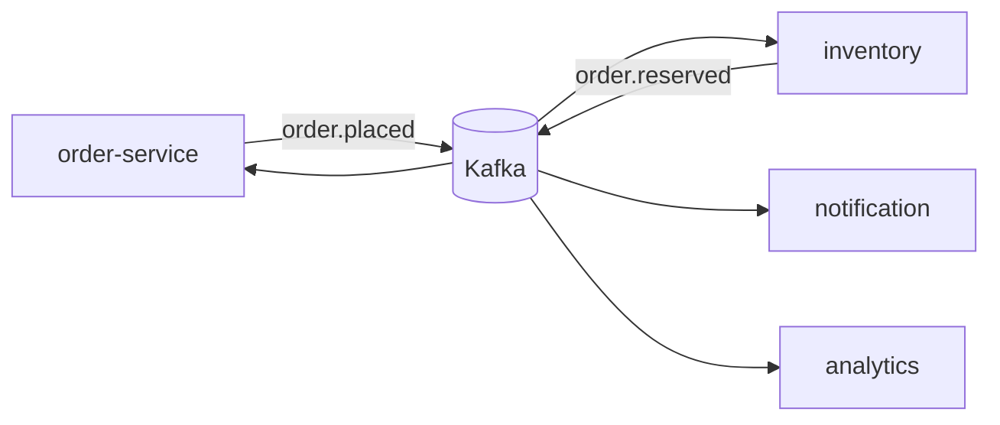

# Project 5 — Event-Driven Orders

## 1. Introduction

Rebuild order processing **around Kafka**: an order service publishes events, and inventory, notification, and analytics services consume them independently. This is the asynchronous, decoupled pattern from module 33 applied to a real flow.

---

## 2. Why This Project Is Important

- The natural capstone after microservices and messaging.
- Teaches **event-driven architecture, idempotency, and replay**.
- Shows you understand the difference between orchestration and choreography.

---

## 3. Real-World Analogy

Think of a **restaurant kitchen with a ticket rail**: the waiter (order service) puts the ticket on the rail; the kitchen, bar, and cashier each take what they need without waiting on each other. Kafka is the rail — the ticket stays there even if someone steps away.

---

## 4. Theory — Design

### Topics
| Topic | Producer | Consumers |
|-------|----------|-----------|
| `order.placed` | order-service | inventory, notification, analytics |
| `order.reserved` | inventory | order-service |
| `payment.processed` | payment | order, notification |

### Principles
- **Choreography:** consumers react to events; no central orchestrator.
- **Idempotency:** consuming the same event twice must be harmless.
- **Ordering:** use one partition per order id (keyed producer).
- **Replay:** reset consumer offset to rebuild state.

---

## 5. Syntax (Core Pattern)

```java
// Producer
kafkaTemplate.send("order.placed", order.id().toString(), order);

// Consumer
@KafkaListener(topics = "order.placed", groupId = "inventory")
public void onOrderPlaced(OrderPlaced event) {
    inventory.reserve(event.items());   // idempotent
}
```

---

## 6. Flow Explanation



---

## 7. Memory Representation

Kafka is a **distributed, durable log**: messages persist and each consumer group tracks its own offset. No point-to-point coupling — any number of consumers can read the same event, and replay just moves an offset back.

---

## 8. Simple Example — Order Event

```java
public record OrderPlaced(
    Long orderId,
    Long userId,
    List<Line> items,
    Instant occurredAt
) {
    public record Line(Long productId, int qty, BigDecimal price) {}
}
```

```java
@Configuration
public class KafkaConfig {
    @Bean
    public KafkaTemplate<String, Object> kafkaTemplate(ProducerFactory<String, Object> pf) {
        return new KafkaTemplate<>(pf);
    }
}
```

---

## 9. Intermediate Example — Producer with Keyed Partitioning

```java
@Service
public class OrderEventPublisher {
    private final KafkaTemplate<String, Object> kafka;

    public void orderPlaced(Order order) {
        OrderPlaced event = OrderPlaced.from(order);
        kafka.send("order.placed", event.orderId().toString(), event)
             .whenComplete((r, ex) -> { if (ex != null) log.error("publish failed", ex); });
    }
}
```

**Why key by orderId:** all events for the same order go to the same partition, preserving per-order ordering.

---

## 10. Advanced Example — Idempotent Consumer

```java
@Component
public class InventoryConsumer {
    private final InventoryRepository inventory;
    private final ProcessedEventRepository processed;   // dedupe store

    @KafkaListener(topics = "order.placed", groupId = "inventory")
    public void reserve(OrderPlaced event) {
        if (processed.exists(event.orderId())) return;   // already handled

        for (OrderPlaced.Line line : event.items()) {
            inventory.decrement(line.productId(), line.qty());
        }
        processed.save(new ProcessedEvent(event.orderId()));   // mark done

        kafka.send("order.reserved", event.orderId().toString(), event);
    }
}
```

```yaml
# application.yml
spring.kafka.consumer:
  group-id: inventory
  auto-offset-reset: earliest   # replay from start when needed
  enable-auto-commit: false
spring.kafka.template.default-topic: order.placed
```

---

## 11. Output

```
Order placed by user 42 → order-service publishes order.placed
Inventory consumer: reserved 2×Keyboard, 1×Mouse → publishes order.reserved
Notification consumer: emailed receipt to user 42
Analytics consumer: recorded order in daily rollup
(All three consumers run at their own pace, no coupling.)
```

---

## 12. Common Mistakes

| Mistake | Correction |
|---------|------------|
| Assuming at-least-once is exactly-once | Make consumers idempotent |
| No dedupe key | Duplicate inventory deductions |
| Ordering across all events | Key by order id (same partition) |
| Auto-commit before processing | Manual offsets after success |
| Consumer dying mid-batch | Enable retries + dead-letter topic |

---

## 13. Best Practices

- Key producers by the aggregate id for ordering.
- Idempotent consumers with a processed-event store.
- `enable-auto-commit: false` + commit after handling.
- Dead-letter topic for poison messages.
- Replay to rebuild state (auto-offset-reset earliest).

---

## 14. Interview Questions

**Q1. At-least-once vs exactly-once?**
*Kafka gives at-least-once by default; build idempotency for the effect.*

**Q2. How do you preserve order for one order?**
*Same partition key; partitions are ordered, topics aren't.*

**Q3. How do you make a consumer idempotent?**
*Dedupe store (order id) + commit offsets after success.*

**Q4. What's a dead-letter queue/topic?**
*A fallback topic for messages that keep failing.*

**Q5. How do you replay events?**
*Reset the consumer group offset to the beginning.*

---

## 15. Practice Exercises

1. Add a `payment.processed` topic and consumer.
2. Add a dead-letter topic with a poison-message handler.
3. Add a stock-audit consumer that writes a daily CSV.
4. Add retry with exponential backoff.

---

## 16. Coding Challenges

1. **Easy:** Publish `order.cancelled` and consume it.
2. **Medium:** Outbox pattern — write event + order in one DB transaction, a relay publishes it.
3. **Hard:** Build a projection (e.g., daily sales rollup) rebuilt entirely from replay.

---

## 17. Summary

- Event-driven choreography with Kafka topics per event.
- Keyed partitioning for ordering, idempotent consumers for safety.
- The capstone that ties modules 32 and 33 together.

➡️ Continue to: [Exercises](Exercises.md)