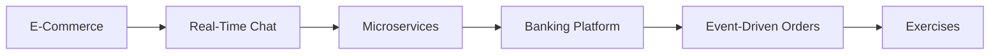

# 37 — Advanced Projects

> **Experience level: 🔴 Expert (3 – 5 years)**

Move from "mini" to **production-scale** builds: an e-commerce backend, a real-time chat app, a microservices system, a banking platform, and an event-driven order pipeline. Each is a multi-week project that combines several enterprise modules (24–35).

---

## 📂 Files in This Module

| File | What You'll Build |
|------|-------------------|
| [Project-1-E-Commerce-Backend.md](Project-1-E-Commerce-Backend.md) | Products, orders, payments, caching |
| [Project-2-Real-Time-Chat.md](Project-2-Real-Time-Chat.md) | WebSockets + STOMP + Redis |
| [Project-3-Microservices-System.md](Project-3-Microservices-System.md) | Multiple services, discovery, gateway |
| [Project-4-Banking-Platform.md](Project-4-Banking-Platform.md) | Accounts, transactions, audit, security |
| [Project-5-Event-Driven-Orders.md](Project-5-Event-Driven-Orders.md) | Kafka-based order processing |
| [Exercises.md](Exercises.md) | Milestones and checklists for all projects |

---

## 🎯 Learning Objectives

By the end of this module, you will be able to:

1. ✅ Design and build a full e-commerce backend.
2. ✅ Add real-time features with WebSockets.
3. ✅ Split a monolith into microservices.
4. ✅ Build a secure, audited banking platform.
5. ✅ Design an event-driven system with Kafka.

---

## 🧭 Module Map



---

## 📌 Quick Preview

```java
@RestController
@RequestMapping("/api/orders")
public class OrderController {
    @PostMapping
    @Transactional
    public OrderPlacement place(@Valid @RequestBody OrderRequest req) {
        Order order = orderService.place(req);       // DB transaction
        eventPublisher.publish("order.placed", order); // Kafka
        return orderService.toPlacement(order);
    }
}
```

---

## 🎓 How to Work on These

- Each project is **multi-week**; plan 2–4 weeks each.
- Commit after every milestone, not at the end.
- Add tests and CI as you go, not at the end.
- Pick **2 projects minimum** (per the roadmap); the E-Commerce and Event-Driven pair well.

---

## Next Module

➡️ [38 — Interview Preparation](../38-Interview-Preparation/README.md) — get job-ready with cheat sheets and mock interviews.