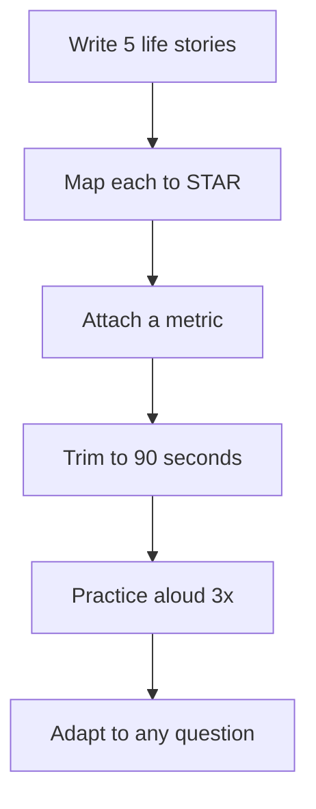

# Behavioral Questions

## 1. Introduction

Behavioral interviews decide offers as much as coding. This file gives you the **STAR framework**, the 10 most-asked questions, and model answers you can adapt to your own story.

---

## 2. Why It's Important

- Technical skills get you to the final round; behavioral stories close the offer.
- The same 10 questions appear at nearly every company.

---

## 3. Real-World Analogy

Think of it as a **job pitch**: you're not reciting a résumé — you're telling three or four short stories that prove you can handle real work.

---

## 4. Theory — The STAR Framework

| Letter | Means | Do |
|--------|-------|----|
| **S**ituation | The context | Set the scene in 1–2 sentences |
| **T**ask | Your responsibility | What were YOU asked to do? |
| **A**ction | What you did | The steps, your choices, why |
| **R**esult | Measurable outcome | Numbers, what you learned |

**Rule:** 70% of the answer on Action + Result. Never answer in generalities — always a specific story.

---

## 5. Syntax — The Story Template

```text
S: "We were rebuilding our order service; outages spiked during sales."
T: "I owned making order placement safe under high concurrency."
A: "I added row-level locking with a fixed lock order, wrote a stress
    test that ran 10k concurrent transfers, and added a dead-letter
    queue for failed events."
R: "Outage-related orders dropped to zero in the next sale, and the
    test suite now runs in CI. I also documented the design for the team."
```

---

## 6. Flow — How to Prepare



---

## 7. Memory Representation

Keep a **story bank** in your head (5 stories, each ~90 seconds): a bug you fixed, a conflict, a failure, a leadership moment, a time you learned something hard. Every question maps to one of these.

---

## 8. The 10 Most-Asked Questions

1. **Tell me about yourself.** — 60-second arc: current → relevant past → why this role.
2. **A challenge you faced?** — STAR, end with what you learned.
3. **A time you failed?** — Own it, show growth (no blame).
4. **Conflict with a teammate?** — Focus on listening + resolution.
5. **A time you disagreed with a decision?** — Data + respectful pushback.
6. **Why do you want this job?** — Specific, not generic.
7. **Where do you see yourself in 5 years?** — Growth, not titles.
8. **Tell me about a time you showed initiative.** — Did more than asked.
9. **How do you handle tight deadlines?** — Priorities + communication.
10. **Why should we hire you?** — 3 strengths + evidence.

---

## 9. Model Answer — "A time you failed"

```text
S: "I shipped a search feature I believed was complete."
T: "I was responsible for the backend endpoint."
A: "I skipped edge-case testing to meet the sprint date. In prod,
    an empty query returned all records — a data leak. I fixed it,
    wrote regression tests, and added a 'ship checklist' to the team."
R: "The checklist became team practice; no similar incident since.
    I learned that speed without verification isn't speed."
```

---

## 10. Model Answer — "Tell me about yourself"

```text
"Over the past year I completed a 38-module Java roadmap end to end —
  from core Java and data structures to Spring Boot, Kafka, and Docker.
  I built five projects, including a secure task-manager API with JWT
  and an event-driven order pipeline. I'm applying because I want to
  build production systems on a team, and your stack — Spring Boot,
  PostgreSQL, Kafka — is exactly where I've been growing."
```

---

## 11. Output — What Good Sounds Like

```text
Good:   "I reduced test time from 14 to 4 minutes by moving to
        parallel CI and caching Maven dependencies."
Vague:  "I made tests faster."
Good:   "I owned it and here's the number."
Vague:  "The team did..."
```

---

## 12. Common Mistakes

| Mistake | Fix |
|---------|-----|
| Rambling | Keep to 90 seconds |
| "We" instead of "I" | Say what YOU did |
| No numbers | Attach a metric |
| Reciting the résumé | Tell stories not lists |
| Trash-talking past teams | Stay professional |

---

## 13. Best Practices

- Prepare 5 stories, not 10 half-answers.
- Always end with a result + lesson.
- Practice aloud with a timer.
- Mirror the question in your first sentence.

---

## 14. Practice Exercises

1. Write your "tell me about yourself" in 60 words.
2. Map 3 of your life stories to STAR.
3. Add a measurable result to each.

---

## 15. Coding Challenges

1. **Easy:** Record yourself answering "tell me about yourself" once.
2. **Medium:** Get a friend to ask the 10 questions cold.
3. **Hard:** Prepare a 5th story — a time you taught/led others.

---

## 16. Summary

- STAR: Situation → Task → Action → Result.
- 5 prepped stories cover every question.
- Practice aloud; measure everything.

➡️ Continue to: [Mock Interview Run](Mock-Interview-Run.md)