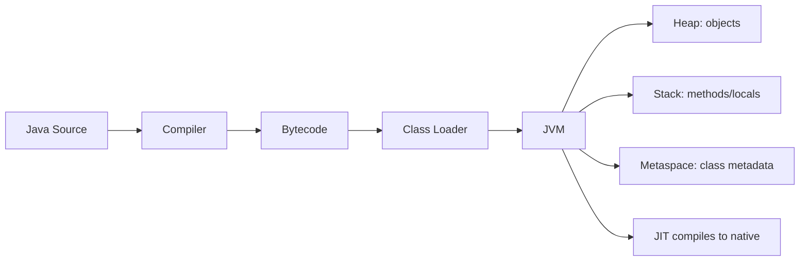

# Core Java Cheat Sheet

## 1. Introduction

Everything from modules 01–16 condensed into **one-page-style refreshers**: JVM, primitives vs objects, strings, OOP, exceptions, collections, concurrency, and Java 8. Use this to revise a topic in minutes before an interview.

---

## 2. Why It's Important

- Interviewers open with core Java — you must be instant and precise.
- These are the "first 10 minutes" answers that set the tone.

---

## 3. Real-World Analogy

This is your **driver's license for the interview**: the examiner first checks the basics before the road test. Nail these and the rest is downhill.

---

## 4. Theory — The 8 Blocks

| Block | Must Know |
|-------|-----------|
| JVM/JDK/JRE | Differences, class loading, JIT |
| Data types | Primitives vs wrappers, memory |
| Strings | Immutability, pool, StringBuilder |
| OOP | 4 pillars, interfaces vs abstract |
| Exceptions | Checked vs unchecked, try-with-resources |
| Collections | Hierarchy, when to use what |
| Concurrency | Threads, synchronized, volatile, locks |
| Java 8 | Lambdas, streams, Optional, dates |

---

## 5. Syntax — One-Liners That Win

```java
// String immutability
String a = "java"; String b = "java";      // same pool ref → true
String c = new String("java");             // new heap object → false
a.equals(c);                               // → true (always compare with equals)

// try-with-resources
try (BufferedReader br = new BufferedReader(new FileReader("f.txt"))) {
    String line = br.readLine();
} // br auto-closed

// Streams
List<Integer> evens = nums.stream().filter(n -> n % 2 == 0).toList();
```

---

## 6. Flow — JVM Memory



---

## 7. Memory Representation

- **Heap:** all objects, shared, garbage-collected.
- **Stack:** per-thread, holds method frames + primitives.
- **String pool:** interns string literals.
- `new` always allocates on the heap.

---

## 8. Collections Quick-Reference

| Interface | Implementation | Characteristics |
|-----------|----------------|-----------------|
| `List` | `ArrayList` | Fast index access |
| `List` | `LinkedList` | Fast insert/delete at ends |
| `Set` | `HashSet` | Unordered, O(1), no dupes |
| `Set` | `LinkedHashSet` | Insertion order |
| `Set` | `TreeSet` | Sorted (Comparable/Comparator) |
| `Map` | `HashMap` | O(1), no order |
| `Map` | `LinkedHashMap` | Insertion order |
| `Map` | `TreeMap` | Sorted keys |
| `Queue` | `ArrayDeque` | FIFO, stack/queue both |

---

## 9. Concurrency One-Liners

```java
// volatile: visibility only
private volatile boolean running = true;

// synchronized: mutual exclusion
public synchronized void inc() { counter++; }

// ReentrantLock: try-lock + fairness
ReentrantLock lock = new ReentrantLock(true);   // fair
lock.lock();
try { work(); } finally { lock.unlock(); }

// Thread pool
ExecutorService pool = Executors.newFixedThreadPool(4);
pool.submit(() -> System.out.println("hi"));
pool.shutdown();
```

---

## 10. Output — "What does this print?"

```java
int x = 5;
Integer y = new Integer(5);
System.out.println(x == y);          // false: unboxing? No — reference compare
System.out.println(y.equals(x));     // true: value compare
```

```text
false
true
```

---

## 11. Common Mistakes in Interviews

| Mistake | Right Answer |
|---------|--------------|
| "Strings are mutable" | Immutable; use StringBuilder |
| "== compares values" | == compares references; equals() values |
| "GC frees everything immediately" | GC is non-deterministic |
| "volatile is a lock" | Only visibility, not atomicity |
| "ArrayList is synchronized" | It's not; use Vector/CopyOnWriteArrayList |

---

## 12. Best Practices to Mention

- Prefer `var`? Say when you use it and why not.
- `equals()`/`hashCode()` contract: equal objects → equal hashes.
- Prefer immutability (`record`, `final`).
- Use interfaces (`List<String>`) over concrete types in APIs.

---

## 13. Interview Questions

**Q1. Difference between JVM, JRE, JDK?**
*JDK = dev tools + JRE. JRE = runtime. JVM = the execution engine.*

**Q2. `==` vs `equals()`?**
*== compares references; equals() compares logical value (must be overridden).*

**Q3. Why is String immutable?**
*Security, caching/hash, thread safety, string pool.*

**Q4. HashMap vs Hashtable vs ConcurrentHashMap?**
*HashMap: not synchronized. Hashtable: synchronized, one lock. ConcurrentHashMap: per-bucket locks.*

**Q5. What does `volatile` do?**
*Ensures visibility across threads; no atomicity.*

---

## 14. Practice Exercises

1. Explain the `equals`/`hashCode` contract aloud.
2. Trace JVM memory for a small program.
3. Name 5 cases where you'd pick `LinkedList` over `ArrayList`.

---

## 15. Coding Challenges

1. **Easy:** Find the first non-repeating character.
2. **Medium:** Implement a thread-safe counter three ways.
3. **Hard:** Explain how `HashMap` handles a collision.

---

## 16. Summary

- 8 core blocks, one-liners, and memory model.
- Collections and concurrency quick references.
- Drill these until instant.

➡️ Continue to: [Spring Cheat Sheet](Spring-Cheat-Sheet.md)