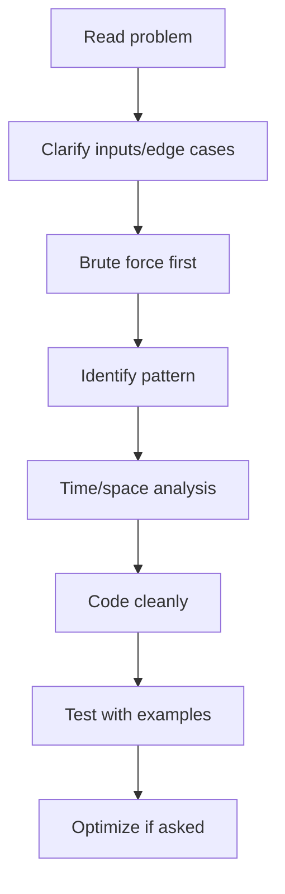

# DSA Interview Questions

## 1. Introduction

The **30 problems that cover ~90% of coding interviews** for Java roles, grouped by pattern. Solve each with a timer, then optimize. Each pattern is one algorithm with a Java implementation.

---

## 2. Why This Set

- Interviewers reuse a small set of patterns.
- These 30 map to arrays, strings, two pointers, sliding window, hashing, stacks, linked lists, trees, graphs, and DP.

---

## 3. Real-World Analogy

Like **practice exams for a driving test**: you don't memorize every road, you master the few maneuvers that show up. These 30 are the maneuvers.

---

## 4. Theory — The Patterns

| Pattern | Classic Problems |
|---------|------------------|
| Two pointers | Two-sum, palindrome, container with most water |
| Sliding window | Longest substring, max sum subarray |
| Hash map | First non-repeating char, group anagrams |
| Stack | Valid parentheses, next greater element |
| Linked list | Reverse, cycle detection, merge two sorted |
| Tree/BFS/DFS | Level order, max depth, lowest common ancestor |
| Graphs | Number of islands, BFS shortest path |
| Binary search | Find in sorted array, search in rotated array |
| DP | Fibonacci, coin change, longest increasing subsequence |
| Sort/merge | Merge intervals, k largest |

---

## 5. Syntax — Master These Snippets

```java
// Two pointer: two sum (sorted)
int i = 0, j = a.length - 1;
while (i < j) {
    int sum = a[i] + a[j];
    if (sum == target) return new int[]{i, j};
    if (sum < target) i++; else j--;
}

// Sliding window: longest substring without repeats
Set<Character> seen = new HashSet<>();
int l = 0, best = 0;
for (int r = 0; r < s.length(); r++) {
    while (seen.contains(s.charAt(r))) seen.remove(s.charAt(l++));
    seen.add(s.charAt(r));
    best = Math.max(best, r - l + 1);
}

// Linked list: Floyd's cycle detection
ListNode slow = head, fast = head;
while (fast != null && fast.next != null) {
    slow = slow.next; fast = fast.next.next;
    if (slow == fast) return true;   // cycle
}
return false;
```

---

## 6. Flow — How to Approach Any Problem



---

## 7. Memory Representation

Know the complexity of each structure:
- Array index: O(1) random access.
- HashMap: O(1) avg.
- Tree/BST: O(log n).
- Sorting: O(n log n).
- BFS/DFS on graph: O(V + E).

---

## 8. Simple — Arrays & Strings

```java
// First non-repeating character
public int firstUniqChar(String s) {
    Map<Character, Integer> counts = new HashMap<>();
    for (char c : s.toCharArray()) counts.merge(c, 1, Integer::sum);
    for (int i = 0; i < s.length(); i++)
        if (counts.get(s.charAt(i)) == 1) return i;
    return -1;
}
```

---

## 9. Intermediate — Stacks & Trees

```java
// Valid parentheses
public boolean isValid(String s) {
    Deque<Character> stack = new ArrayDeque<>();
    Map<Character, Character> match = Map.of(')', '(', ']', '[', '}', '{');
    for (char c : s.toCharArray()) {
        if (match.containsKey(c)) {
            if (stack.isEmpty() || stack.pop() != match.get(c)) return false;
        } else stack.push(c);
    }
    return stack.isEmpty();
}

// Max depth of binary tree
public int maxDepth(TreeNode root) {
    if (root == null) return 0;
    return 1 + Math.max(maxDepth(root.left), maxDepth(root.right));
}
```

---

## 10. Advanced — Graphs & DP

```java
// Number of islands (DFS)
public int numIslands(char[][] grid) {
    int count = 0;
    for (int i = 0; i < grid.length; i++)
        for (int j = 0; j < grid[0].length; j++)
            if (grid[i][j] == '1') { count++; sink(grid, i, j); }
    return count;
}
private void sink(char[][] g, int i, int j) {
    if (i < 0 || j < 0 || i >= g.length || j >= g[0].length || g[i][j] != '1') return;
    g[i][j] = '0';
    sink(g, i+1, j); sink(g, i-1, j); sink(g, i, j+1); sink(g, i, j-1);
}

// Fibonacci with memoization
int fib(int n, int[] memo) {
    if (n <= 1) return n;
    if (memo[n] != 0) return memo[n];
    return memo[n] = fib(n-1, memo) + fib(n-2, memo);
}
```

---

## 11. Output — Target Complexities

```text
Two sum          → O(n)  time, O(n) space (hash)  / O(1) if sorted + 2 pointers
Longest substr   → O(n) sliding window
Valid parens     → O(n) stack
Num islands      → O(R×C) DFS
Coin change      → O(amount × coins) DP
```

---

## 12. Common Mistakes

| Mistake | Fix |
|---------|-----|
| Jumping to code | Clarify + brute force first |
| Forgetting edge cases | Empty input, single element, negatives |
| Not stating complexity | Always say O() before coding |
| Mutating the input | Ask if allowed |
| Stack overflow in DFS | Use iterative + explicit stack |

---

## 13. Best Practices

- Talk through your reasoning out loud.
- Start with brute force, then optimize.
- Test with an example and an edge case.
- Ask about space constraints.

---

## 14. Interview Questions

**Q1. How do you decide between recursion and iteration?**
*Recursion is clean for trees/DP; iteration avoids stack overflow on big inputs.*

**Q2. When is a hash map better than a sorted array?**
*O(1) lookups vs O(log n); no order needed.*

**Q3. What's the trade-off of memoization?**
*Extra O(n) space for time savings.*

**Q4. BFS vs DFS when?**
*BFS = shortest path in unweighted; DFS = reachability/all paths.*

---

## 15. Practice Exercises

1. Solve 3 problems from the "simple" list in 45 minutes.
2. Say the time/space complexity for each before coding.

---

## 16. Coding Challenges

1. **Easy:** Two sum, valid parentheses, max depth.
2. **Medium:** Longest substring, islands, coin change.
3. **Hard:** LRU cache, merge intervals, top-K frequent.

---

## 17. Summary

- 30 problems across 10 patterns.
- Approach: clarify → brute → pattern → complexity → code.
- Practice timed — speed matters.

➡️ Continue to: [SQL & Database Questions](SQL-and-Database-Questions.md)