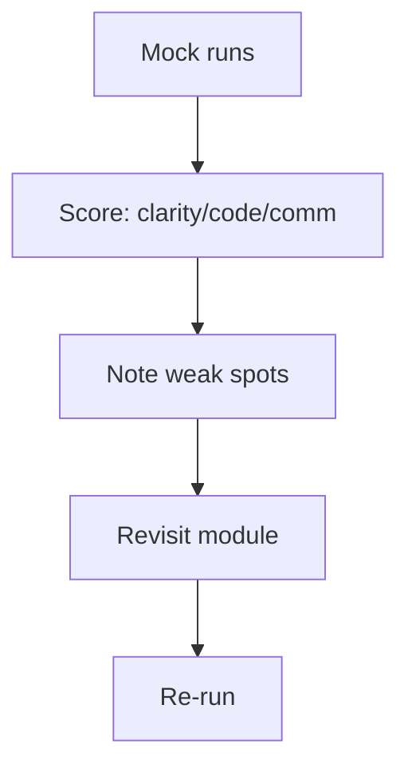

# Mock Interview Run

## 1. Introduction

A **full timed practice interview** you can run with a friend, or alone with a timer. It mirrors a real Java backend interview: a 15-minute behavioral block, a 25-minute coding block, a 15-minute technical quiz, and a short system-design stretch.

---

## 2. Why It's Important

- Interview performance is a **skill you can rehearse**.
- Timing out on easy questions is the #1 avoidable failure.

---

## 3. Real-World Analogy

Like a **fire drill**: you rehearse the route before there's a fire so the real one feels familiar. A mock interview makes the real day feel routine.

---

## 4. Theory — The Run Format

| Block | Time | What |
|-------|------|------|
| 1. Behavioral | 15 min | STAR stories |
| 2. Coding | 25 min | One DSA problem, aloud |
| 3. Technical quiz | 15 min | Core Java + Spring rapid-fire |
| 4. System design | 20 min | High-level, framework only |
| **Total** | **~75 min** | Add 10 min debrief |

---

## 5. Syntax — The Session Script

```text
"Hello! This is a 75-minute mock interview for a Java backend role.
  I'll start with some behavioral questions, then a coding problem,
  then a quick technical quiz, and a system design if time allows."

Block 1 — Behavioral (15 min):
  1. Tell me about yourself. (2 min)
  2. Tell me about a technical challenge you overcame.
  3. Tell me about a time you disagreed with a teammate.
  4. Why are you interested in this role?

Block 2 — Coding (25 min):
  "Reverse a linked list. Discuss complexity.
   Then: given an array, find the two numbers that sum to a target."
```

---

## 6. Flow — The Debrief



---

## 7. Memory Representation

Track a scorecard per run:

```text
Clarity of explanation   /5
Correct algorithm        /5
Code cleanliness         /5
Edge cases caught        /5
Time management          /5
Behavioral story impact  /5
TOTAL                    /30
```

---

## 8. Coding Problem — Reverse a Linked List (with answer)

```java
public ListNode reverseList(ListNode head) {
    ListNode prev = null, cur = head;
    while (cur != null) {
        ListNode next = cur.next;   // save
        cur.next = prev;            // reverse
        prev = cur;                 // advance
        cur = next;
    }
    return prev;
}
// Time O(n), space O(1). Edge cases: empty list, single node.
```

---

## 9. Technical Quiz — 10 Rapid-Fire Questions

```text
1.  `==` vs `equals()`?          → refs vs values
2.  String immutable? why?       → pool, security, thread-safety
3.  HashMap vs TreeMap?          → O(1) vs sorted O(log n)
4.  `@Transactional` rollback?   → RuntimeException default
5.  `@RestController` vs `@Controller`? → + @ResponseBody
6.  ACID?                        → Atomicity, Consistency, Isolation, Durability
7.  `volatile`?                  → visibility only
8.  JWT stateless? why?          → identity in the token, no session
9.  N+1 problem?                 → lazy fetch, join fetch/DTOs
10. `PreparedStatement`?         → injection-safe, precompiled
```

---

## 10. System Design Stretch (20 min)

```text
"Design a URL shortener."
Framework answer (8 steps):
  1. Clarify: 10M users, 100M reads/day, 1M writes/day
  2. Reqs: create + read, low latency, analytics optional
  3. Estimate: ~1200 QPS peak, 100:1 read:write
  4. API: POST /shorten, GET /{id}
  5. High-level: LB → API → Redis cache → DB + ID gen
  6. Detail: base62 id, cache-aside, shard by id
  7. Bottlenecks: hot keys, DB writes
  8. Scale: sharding, replicas, CDN for JS
```

---

## 11. Output — Debrief Scorecard Example

```text
Clarity   4  — hesitated on locking question
Algorithm 5  — reversed list cleanly, stated O(n)/O(1)
Code      5  — no syntax errors, good naming
Edge cases4  — caught empty list, missed null target
Time      4  — 18 min to solution, fine
Behavior  4  — strong STAR, slightly long
TOTAL     26/30 → re-run to 28+
```

---

## 12. Common Mistakes

| Mistake | Fix |
|---------|-----|
| Skipping the debrief | Score every run |
| Not timing the coding block | Use a real timer |
| Preparing answers, not questions | Ask clarifications |
| Rehearsing silently | Speak aloud |
| Doing one run only | Repeat until 28+/30 |

---

## 13. Best Practices

- Run at least 2 full mock interviews before the real one.
- Ask a friend to be the interviewer; record audio.
- Review the recording for filler words ("um", "like").
- Time-box every answer.

---

## 14. Practice Exercises

1. Run Block 2 (coding) alone with a 25-minute timer.
2. Run Block 3 (quiz) rapid-fire — 30 seconds per answer.
3. Debrief yourself honestly with the scorecard.

---

## 15. Coding Challenges

1. **Easy:** Mock the behavioral block with a friend.
2. **Medium:** Full 75-minute run with a timer + recording.
3. **Hard:** Two runs in one week; compare scorecards.

---

## 16. Summary

- 75-minute format: behavioral + coding + quiz + design.
- Scorecard-driven improvement, rerun until 28+/30.
- The real interview is now just another rehearsal.

🎉 **You've completed the entire Java Complete Roadmap.**

➡️ Back to the [Roadmap](../ROADMAP.md) to tick off the final modules.