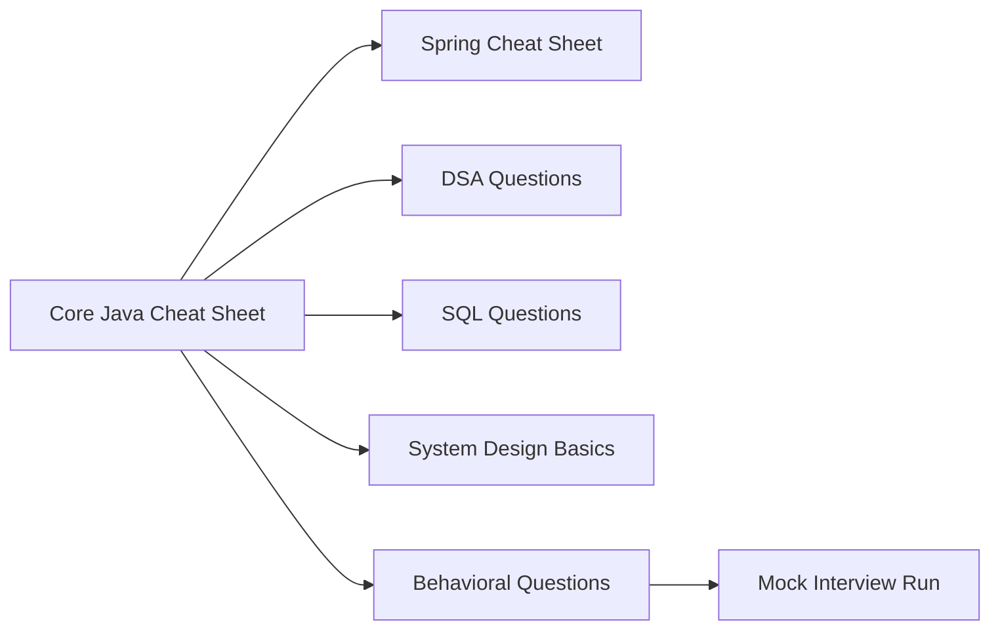

# 38 — Interview Preparation

> **Experience level: 🔴 Expert (3 – 5 years)**

Get **job-ready**: core-Java cheat sheets, a DSA problem bank, behavioral question frameworks, system design prep, and full mock-interview runs. This is the final module of the roadmap — everything before it was building toward this.

---

## 📂 Files in This Module

| File | What You'll Master |
|------|---------------------|
| [Core-Java-Cheat-Sheet.md](Core-Java-Cheat-Sheet.md) | One-page core Java + JVM + concurrency recap |
| [Spring-Cheat-Sheet.md](Spring-Cheat-Sheet.md) | Spring Boot, JPA, security, microservices recap |
| [DSA-Interview-Questions.md](DSA-Interview-Questions.md) | The 30 problems that cover 90% of interviews |
| [SQL-and-Database-Questions.md](SQL-and-Database-Questions.md) | SQL, indexes, transactions, normalization |
| [System-Design-Basics.md](System-Design-Basics.md) | Design a system interview essentials |
| [Behavioral-Questions.md](Behavioral-Questions.md) | STAR answers + the 10 most-asked questions |
| [Mock-Interview-Run.md](Mock-Interview-Run.md) | A full timed practice interview script |

---

## 🎯 Learning Objectives

By the end of this module, you will be able to:

1. ✅ Recite core Java and Spring concepts in one sitting.
2. ✅ Solve the essential DSA problems under time pressure.
3. ✅ Answer SQL and design questions with confidence.
4. ✅ Deliver crisp behavioral stories using STAR.
5. ✅ Perform a complete mock interview end to end.

---

## 🧭 Module Map



---

## 📌 Quick Preview

```java
// The ONE concurrency answer to know cold
private final ReentrantLock lock = new ReentrantLock();

public void safeIncrement() {
    lock.lock();
    try { counter++; } finally { lock.unlock(); }
}
```

---

## 🎓 How to Use This Module

1. **Daily:** skim a cheat sheet for 30 minutes.
2. **Weekly:** solve 3–5 DSA problems with a timer.
3. **Before interviews:** run the full Mock Interview script twice.
4. Revisit any weak section by going back to its module (01–37).

---

## Next Module

🎉 You've completed the entire roadmap! Revisit the [Roadmap](../ROADMAP.md) and tick off what you've finished.