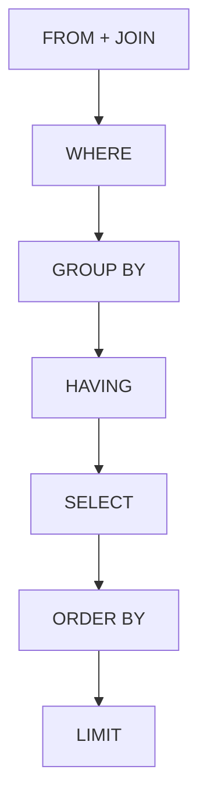

# SQL & Database Questions

## 1. Introduction

The SQL and database concepts that show up in **every Java backend interview**: queries, joins, indexes, transactions, normalization, and the trade-offs interviewers probe.

---

## 2. Why It's Important

- Every Spring backend talks to a database.
- Interviewers ask one SQL query question + one theory question, guaranteed.

---

## 3. Real-World Analogy

The database is the **bank's ledger** — the source of truth. Everything you know about correctness, performance, and consistency in Java is meaningless if the SQL behind it is wrong.

---

## 4. Theory — The Topics

| Topic | Must Know |
|-------|-----------|
| Joins | INNER, LEFT, RIGHT, FULL — row semantics |
| Aggregation | GROUP BY, HAVING vs WHERE |
| Indexes | When they help, cost of writes |
| Normalization | 1NF–3NF, why 3NF is the default |
| Transactions | ACID, isolation levels |
| Locking | Row vs table, optimistic vs pessimistic |
| N+1 | The Java↔SQL performance trap |
| Pagination | LIMIT/OFFSET and its cost |

---

## 5. Syntax — The Query You'll Be Asked

```sql
-- Orders with customer name (LEFT JOIN keeps all orders)
SELECT o.id, o.total, c.name
FROM orders o
LEFT JOIN customers c ON o.customer_id = c.id
WHERE o.created_at >= '2026-01-01'
ORDER BY o.total DESC
LIMIT 10;
```

```sql
-- Second-highest salary (classic)
SELECT MAX(salary) FROM employees
WHERE salary < (SELECT MAX(salary) FROM employees);
```

```sql
-- Count by category (GROUP BY + HAVING)
SELECT category_id, COUNT(*) AS cnt
FROM products
GROUP BY category_id
HAVING COUNT(*) > 5;
```

---

## 6. Flow — Query Execution Order



---

## 7. Memory Representation — Indexes

An index is like the **index at the back of a book**: it lets the DB jump to rows instead of scanning the whole table. Costs: extra storage and slower writes (every insert must update the index).

---

## 8. Simple — CRUD & WHERE

```sql
INSERT INTO products (name, price) VALUES ('Keyboard', 49.99);

UPDATE products SET price = 39.99 WHERE id = 7;

SELECT * FROM products WHERE price BETWEEN 20 AND 60 ORDER BY price;

DELETE FROM products WHERE id = 7;
```

---

## 9. Intermediate — Aggregates & Joins

```sql
SELECT c.name, SUM(o.total) AS spent
FROM customers c
JOIN orders o ON o.customer_id = c.id
GROUP BY c.name
HAVING SUM(o.total) > 1000
ORDER BY spent DESC;
```

---

## 10. Advanced — Transactions & Locking (the Java tie-in)

```sql
-- Pessimistic lock: prevents two transfers clobbering a balance
SELECT * FROM accounts WHERE id = 1 FOR UPDATE;
UPDATE accounts SET balance = balance - 100 WHERE id = 1;
```

```sql
-- Optimistic: version check
UPDATE accounts SET balance = balance - 100, version = version + 1
WHERE id = 1 AND version = 5;   -- 0 rows → someone else changed it → retry
```

---

## 11. Output — Semantics to State

```text
INNER JOIN → only matching rows
LEFT JOIN  → all left rows, NULLs for unmatched right
WHERE      → filters rows before grouping
HAVING     → filters groups after grouping
COUNT(*)   → counts rows incl. NULLs; COUNT(col) excludes NULLs
```

---

## 12. Common Mistakes

| Mistake | Fix |
|---------|-----|
| WHERE on an unindexed column at scale | Add an index |
| Filtering in HAVING that belongs in WHERE | Use WHERE for rows, HAVING for groups |
| Selecting `*` in production | Name the columns |
| OFFSET pagination on big tables | Keyset pagination |
| `double` columns for money | DECIMAL/NUMERIC |

---

## 13. Best Practices

- Index columns used in `WHERE`/`JOIN`/`ORDER BY`.
- Use `EXPLAIN` to verify the plan.
- Always use parameters (`PreparedStatement`), never string concatenation.
- Transactions for multi-statement operations.
- Prefer keyset pagination over OFFSET at scale.

---

## 14. Interview Questions

**Q1. ACID?**
*Atomicity, Consistency, Isolation, Durability.*

**Q2. Isolation levels?**
*READ UNCOMMITTED → READ COMMITTED → REPEATABLE READ → SERIALIZABLE; trade consistency for concurrency.*

**Q3. Indexes always good?**
*No — slower writes, more storage; index what you read, not what you write often.*

**Q4. N+1 in JPA?**
*Lazy fetch → one query per row. Fix: fetch joins or DTO projections.*

**Q5. Optimistic vs pessimistic?**
*Optimistic: version + retry (low contention). Pessimistic: lock rows (high contention/safety).*

---

## 15. Practice Exercises

1. Write the second-highest-salary query from memory.
2. Explain LEFT JOIN row semantics on a concrete example.
3. Sketch when to use each isolation level.

---

## 16. Coding Challenges

1. **Easy:** Top-5 selling products by revenue.
2. **Medium:** Detect duplicate emails with GROUP BY + HAVING.
3. **Hard:** Design a schema for an e-commerce site to 3NF and index it.

---

## 17. Summary

- Joins, aggregation, indexes, transactions, and locking.
- The Java tie-ins: PreparedStatement, N+1, isolation.
- One question covers SQL, one covers theory — you're set.

➡️ Continue to: [System Design Basics](System-Design-Basics.md)