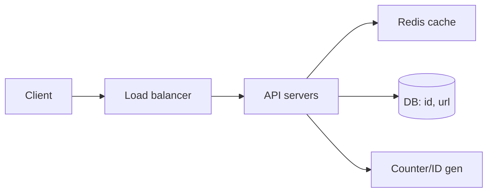

# System Design Basics

## 1. Introduction

The fundamentals for **"design a system" interviews** — the format that decides senior-level offers. You'll learn a repeatable framework and the vocabulary (scaling, caching, queues, sharding) to answer any design question.

---

## 2. Why It's Important

- Junior interviews: maybe one design question.
- Senior interviews: always. It's 40–50% of the interview.

---

## 3. Real-World Analogy

You're an **architect presenting blueprints**: you don't write the plumbing code yet — you show rooms, doors, pipes, and fire exits, and explain why each choice. Same idea with services, databases, caches, and queues.

---

## 4. Theory — The Framework

### The 8-Step Approach
| Step | Do |
|------|----|
| 1. Clarify | Users, scale, features, constraints |
| 2. Requirements | Functional + non-functional (latency, availability) |
| 3. Estimate | QPS, storage, bandwidth (rough) |
| 4. API | Endpoints + data model |
| 5. High-level | Diagram components + flow |
| 6. Detail | DB, caching, queues, sharding |
| 7. Bottlenecks | Where does it break? |
| 8. Scalability | How to grow it |

---

## 5. Syntax — The Numbers to Know

```text
Daily active users        → 1M
Requests per day          → 100M
Requests per second       → ~1200 peak
Storage per user (small)  → 10 KB
Order of magnitude        → ~100 GB / month
QPS rule of thumb         → peak = 2–3 × average
```

---

## 6. Flow — Design a URL Shortener



---

## 7. Memory Representation — Components Cheat-Sheet

| Component | Solves | Trade-off |
|-----------|--------|-----------|
| Load balancer | Distribute traffic | Adds a hop |
| Cache (Redis) | Read latency, DB load | Stale data, eviction |
| Queue (Kafka) | Decouple + buffer spikes | Eventual consistency |
| Sharding | Write scale | Cross-shard queries |
| CDN | Static content latency | Cache invalidation |
| Read replica | Read scale | Replication lag |
| Index | Query speed | Write cost |

---

## 8. Simple — Requirement Clarification Script

```text
Interviewer: Design a URL shortener.

You: Before designing —
  1. Users: how many? (say ~10M DAU)
  2. Features: create, read, expire?
  3. Write volume: how many new URLs per day?
  4. Read:write ratio? (typical 100:1)
  5. Latency target? Analytics?
```

---

## 9. Intermediate — High-Level Design Answer

```java
// Core flow as pseudocode
// POST /api/shorten  { longUrl }
//   id = counter.nextId()          → base62 encode
//   store (shortId, longUrl) in DB
//   cache.put(shortId, longUrl) in Redis
// GET /{shortId}
//   if redis.has(shortId) return redis.get
//   else load DB → fill cache → redirect 302
```

---

## 10. Advanced — Scaling Deep-Dive (DB & Caching)

```text
DB choice:  relational for transactions
            (users, orders) OR NoSQL for scale (logs, events)

Write scale:  shard by user_id / shortId
Read scale:   read replicas + cache-aside:
              cache miss → DB → write-through to cache

Reliability:  replicas, failover, backups
Availability: target 99.9% → allow ~8.7h/yr downtime
Latency:      P99 < 200ms
```

---

## 11. Output — What the Interviewer Scores

```text
Clarification       → 20%  (don't build the wrong thing)
Estimation          → 10%  (ballpark numbers)
High-level design   → 30%  (clear diagram + components)
Deep dives          → 30%  (pick 2: DB/cache/queue/shard)
Trade-off reasoning → 10%  ("we chose X because...")
```

---

## 12. Common Mistakes

| Mistake | Fix |
|---------|-----|
| Jumping to code | Diagram first, code never needed |
| No scale numbers | Estimate QPS/storage |
| Everything in a monolith | Show separation, then justify |
| Ignoring non-functional | Ask latency/availability |
| One correct answer | Multiple designs, discuss trade-offs |

---

## 13. Best Practices

- Talk, don't type. Diagrams win.
- Always mention the cache + queue early.
- Quantify: "100:1 read:write", "P99 200ms".
- Explicitly say what you'd do at 10× growth.

---

## 14. Interview Questions

**Q1. Design a URL shortener** — base62, cache-aside, shard by id.

**Q2. Design a chat system** — WebSockets, message queue, history store.

**Q3. Design a news feed** — fan-out on write vs on read, cache per user.

**Q4. Design an e-commerce cart** — idempotency, inventory lock, eventual consistency.

**Q5. Design a rate limiter** — token bucket, Redis counters, per-user.

---

## 15. Practice Exercises

1. Design a URL shortener from the 8-step framework.
2. Design a news feed (Twitter-like) and compare fan-out strategies.
3. Design a rate limiter with a token bucket.

---

## 16. Coding Challenges

1. **Easy:** Estimate QPS/storage for 10M users.
2. **Medium:** Design the DB schema + indexes for a feed.
3. **Hard:** Compare sharding by userId vs by contentId — when each.

---

## 17. Summary

- The 8-step framework and the numbers to quote.
- Components cheat-sheet: LB, cache, queue, sharding, replicas.
- Practice 2–3 designs aloud before the real thing.

➡️ Continue to: [Behavioral Questions](Behavioral-Questions.md)