# ROADMAP.md

> The complete learning path for the **Java Complete Roadmap** repository. Use this to track your progress — tick off each module as you complete it.

---

## 🗺️ Roadmap Overview

```mermaid
flowchart TD
    A[01 Introduction to Java] --> B[02 Environment Setup]
    B --> C[03 Git & Version Control]
    C --> D[04 Java Basics]
    D --> E[05 Control Statements]
    E --> F[06 Methods]
    F --> G[07 Arrays]
    G --> H[08 Strings]
    H --> I[09 OOP]
    I --> J[10 Exception Handling]
    J --> K[11 Packages & Access Modifiers]
    K --> L[12 Collections Framework]
    L --> M[13 File Handling]
    M --> N[14 Multithreading]
    N --> O[15 Generics]
    O --> P[16 Java 8 Features]
    P --> Q[17 Logging]
    Q --> R[18 SQL & Databases]
    R --> S[19 JDBC]
    S --> T[20 Maven]
    T --> U[21 Gradle]
    U --> V[22 Design Patterns]
    V --> W[23 DSA in Java]
    W --> X[24 Servlets & JSP]
    X --> Y[25 Spring Core]
    Y --> Z[26 Spring Boot]
    Z --> AA[27 REST API]
    AA --> AB[28 Spring MVC & Thymeleaf]
    AB --> AC[29 Spring Security]
    AC --> AD[30 Hibernate & JPA]
    AD --> AE[31 Caching]
    AE --> AF[32 Microservices]
    AF --> AG[33 Messaging]
    AG --> AH[34 Unit Testing]
    AH --> AI[35 Docker]
    AI --> AJ[36 Mini Projects]
    AJ --> AK[37 Advanced Projects]
    AK --> AL[38 Interview Preparation]
```

---

## 📈 Learning Phases & Experience Levels

The 38 modules fall into **6 logical phases**. Each maps to an **experience level** (0–5 years), so you always know the "level" of any module — great for freshers planning a study order and for experienced developers picking refresher modules.

| Phase | Modules | Experience Level | Focus | Outcome |
|-------|---------|------------------|-------|---------|
| 🟢 **Phase 1 — Foundations** | 01–04 | 🆕 0–6 months | Setup, Git, syntax, control flow | Write simple standalone programs, versioned with Git |
| 🔵 **Phase 2 — Core Java** | 05–11 | 🟡 6 months–1 year | Methods, arrays, strings, OOP, exceptions, packages | Write clean object-oriented code |
| 🟠 **Phase 3 — Intermediate** | 12–16 | 🟠 1–2 years | Collections, files, threads, generics, Java 8 | Build robust data-driven applications |
| 🟣 **Phase 4 — Backend Stack** | 17–21 | 🟣 2–3 years | Logging, SQL, JDBC, Maven, Gradle | Log, store data, and build professionally |
| 🟤 **Phase 5 — Design & DSA** | 22–23 | 🟤 2–4 years | Patterns, algorithms, data structures | Solve problems like a professional |
| 🔴 **Phase 6 — Enterprise & Jobs** | 24–38 | 🔴 3–5 years | Servlets, Spring, REST, security, caching, messaging, Docker, projects, interviews | Build real applications and clear interviews |

### Experience-Level Badges (used across module READMEs)

| Badge | Experience | Typical Job Title |
|-------|-----------|-------------------|
| 🆕 **Beginner** | 0–6 months | Intern / Trainee |
| 🟡 **Basic+** | 6 months–1 year | Junior Developer (0–1 yr) |
| 🟠 **Intermediate** | 1–2 years | Junior/Mid Developer |
| 🟣 **Advanced** | 2–4 years | Mid/Senior Developer |
| 🔴 **Expert / Job-Ready** | 3–5 years | Senior / Interview-ready |

---

## ✅ Progress Checklist

Check off each box as you complete the module.

### Phase 1 — Foundations
- [ ] **01 — Introduction to Java** — History, features, JVM/JRE/JDK, how Java compiles & runs
- [ ] **02 — Environment Setup** — JDK installed, IDE configured, first program runs
- [ ] **03 — Git & Version Control** — Repos, commits, branches, GitHub, undoing changes
- [ ] **04 — Java Basics** — Variables, data types, operators, user input, casting

### Phase 2 — Core Java
- [ ] **05 — Control Statements** — if/else, switch, all loops, break/continue, patterns
- [ ] **06 — Methods** — Syntax, parameters, return values, overloading, recursion
- [ ] **07 — Arrays** — Single & 2D arrays, loops, common algorithms
- [ ] **08 — Strings** — Immutability, String pool, StringBuilder, key methods
- [ ] **09 — OOP** — Classes, objects, inheritance, polymorphism, interfaces, abstraction
- [ ] **10 — Exception Handling** — try/catch/finally, custom exceptions, best practices
- [ ] **11 — Packages & Access Modifiers** — Package structure, access levels

### Phase 3 — Intermediate
- [ ] **12 — Collections Framework** — List, Set, Map, Queue, sorting, algorithms
- [ ] **13 — File Handling** — Byte/character streams, NIO
- [ ] **14 — Multithreading** — Threads, Runnable, synchronization, executors
- [ ] **15 — Generics** — Generic types, methods, wildcards
- [ ] **16 — Java 8 Features** — Lambdas, streams, Optional, default methods, dates

### Phase 4 — Backend Stack
- [ ] **17 — Logging** — Levels, SLF4J, Logback, structured logs, MDC
- [ ] **18 — SQL & Databases** — Relational design, CRUD, queries, transactions
- [ ] **19 — JDBC** — Connect to MySQL, CRUD, prepared statements
- [ ] **20 — Maven** — Build automation, dependencies, project lifecycle
- [ ] **21 — Gradle** — Modern build tooling, tasks, plugins

### Phase 5 — Design & DSA
- [ ] **22 — Design Patterns** — Creational, structural, behavioral patterns
- [ ] **23 — DSA in Java** — Big-O, data structures, sorting & searching, common problems

### Phase 6 — Enterprise & Jobs
- [ ] **24 — Servlets & JSP** — HTTP handling, lifecycle, sessions, JSP views
- [ ] **25 — Spring Core** — IoC, dependency injection, beans
- [ ] **26 — Spring Boot** — Auto-configuration, REST controllers, starters
- [ ] **27 — REST API** — HTTP, REST design, JSON, error handling
- [ ] **28 — Spring MVC & Thymeleaf** — Controllers, views, forms, validation
- [ ] **29 — Spring Security** — Authentication, authorization, JWT
- [ ] **30 — Hibernate & JPA** — ORM, entities, relationships, repositories
- [ ] **31 — Caching** — @Cacheable, Redis, Caffeine, invalidation
- [ ] **32 — Microservices** — Service breakdown, discovery, resilience
- [ ] **33 — Messaging** — Queues, RabbitMQ, Kafka, idempotency
- [ ] **34 — Unit Testing** — JUnit, assertions, mocking, TDD
- [ ] **35 — Docker** — Images, containers, Dockerfile, Compose
- [ ] **36 — Mini Projects** — Complete at least 3 of the 5 projects
- [ ] **37 — Advanced Projects** — Complete at least 2 of the 5 projects
- [ ] **38 — Interview Preparation** — Cheat sheets revised, mock interviews attempted

---

## 🕒 Suggested Weekly Plan (8 Weeks)

| Week | Modules | Time per day |
|------|---------|--------------|
| Week 1 | 01, 02, 03, 04 | 1.5–2 hours |
| Week 2 | 05, 06, 07, 08 | 2 hours |
| Week 3 | 09, 10, 11, 12 | 2 hours |
| Week 4 | 13, 14, 15, 16 | 2–2.5 hours |
| Week 5 | 17, 18, 19, 20 | 2–2.5 hours |
| Week 6 | 21, 22, 23, 24 | 2–2.5 hours |
| Week 7 | 25–31 (pick key ones) | 2–3 hours |
| Week 8 | 32–38 (pick key ones) | 2–3 hours |

> **📌 Note:** The enterprise modules (24–38) are deep. If you're on a tight schedule, build a solid Spring Boot project from modules 25–30 and treat 31–35 as a second pass before the project and interview modules.

---

## 🔗 Quick Links

- [Start at Module 01](01-Introduction-to-Java/README.md)
- [Installation Guide](INSTALLATION.md)
- [External Resources](RESOURCES.md)
- [Main README](README.md)